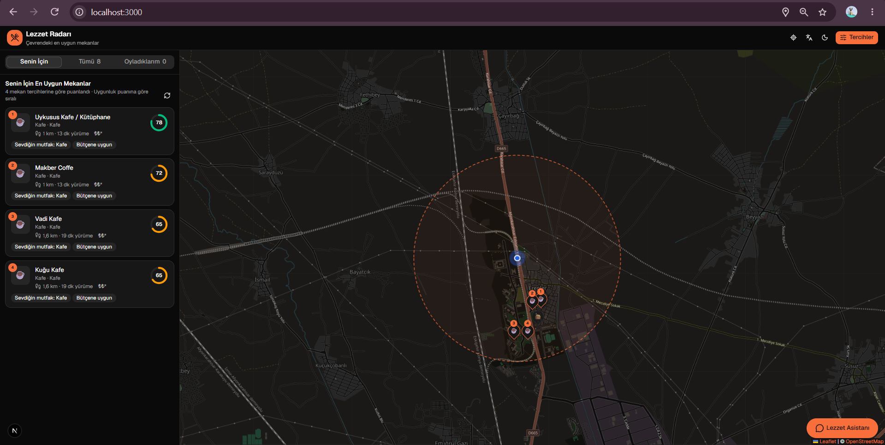
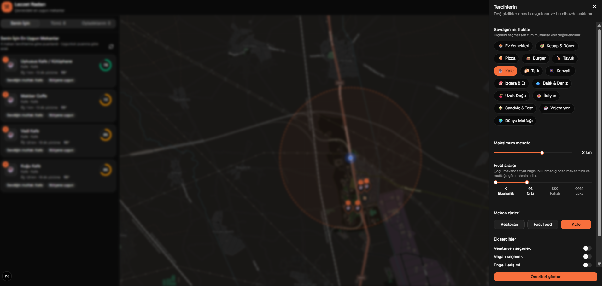
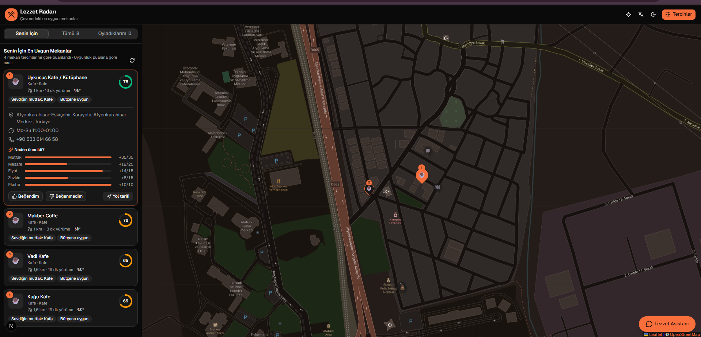
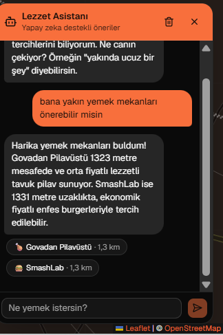
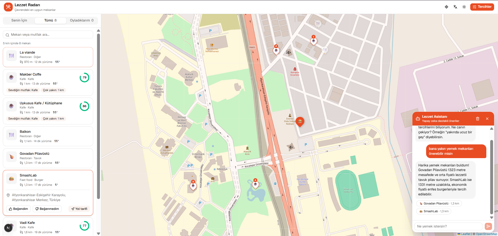
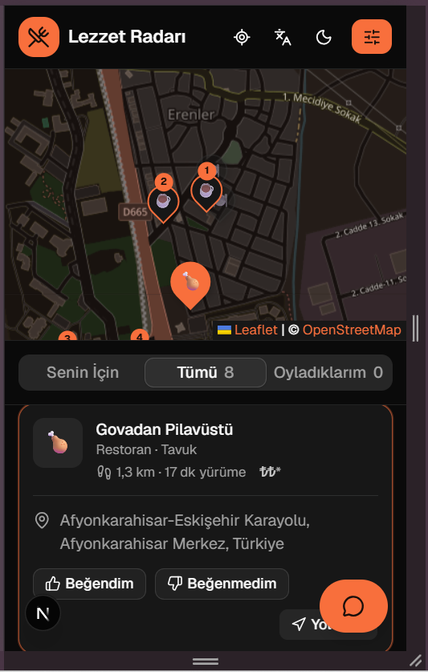
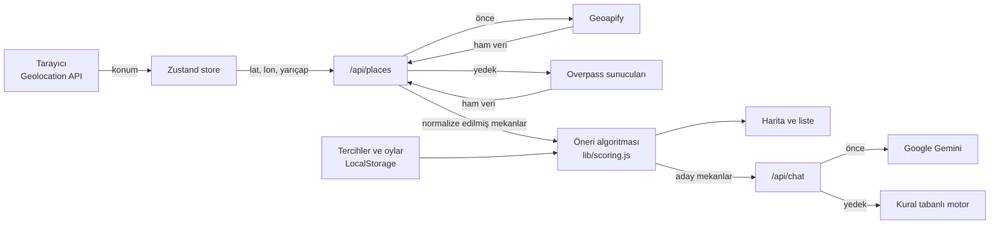

# Lezzet Radarı

**Akıllı Restoran Öneri ve Harita Uygulaması**

Lezzet Radarı, kullanıcının anlık konumunu bularak çevresindeki restoran, kafe ve fast-food mekanlarını interaktif bir harita üzerinde gösteren, kullanıcının tercihlerine göre her mekana bir uygunluk puanı verip "Senin İçin En Uygun Mekanlar" listesi oluşturan bir web uygulamasıdır.


---

## İçindekiler

- [Özellikler](#özellikler)
- [Ekran Görüntüleri](#ekran-görüntüleri)
- [Kurulum](#kurulum)
- [Kullanım ve Akış](#kullanım-ve-akış)
- [Teknik Tercihler](#teknik-tercihler)
- [Dosya Yapısı](#dosya-yapısı)
- [Test ve CI/CD](#test-ve-cicd)

---

## Özellikler

### Temel özellikler

| Özellik | Açıklama |
|---|---|
| **Konum ve harita** | Tarayıcının Geolocation API'si ile konum canlı olarak takip edilir ve Leaflet haritasında işaretlenir. Konum izni verilmezse haritadan elle konum seçilebilir. |
| **Canlı veri** | Çevredeki restoran, kafe ve fast-food mekanları (ad, mutfak türü, adres, çalışma saatleri) OpenStreetMap tabanlı API'lerden anlık olarak alınır. |
| **Tercih profili** | Mutfak türleri, maksimum mesafe (250 m – 5 km), fiyat aralığı, mekan türü ve vegan / vejetaryen / tekerlekli sandalye tercihleri. |
| **Kişiselleştirilmiş öneri** | Her mekan 0-100 arasında puanlanır ve neden önerildiği gösterilir ("Seçtiğin mutfak", "Çok yakın", "Bütçene uygun"). |
| **Lokal veri yönetimi** | Tercihler, beğenilen ve beğenilmeyen mekanlar LocalStorage'da kalıcı olarak saklanır. |

### Bonus özellikler

| Özellik | Açıklama |
|---|---|
|  **Karanlık / aydınlık tema** | Aydınlık, karanlık ve sistem teması; harita da temaya uyum sağlar. |
|  **Yapay zekâ destekli chatbot** | "Lezzet Asistanı", Google Gemini ile doğal dilde mekan önerir. Gemini'ye ulaşılamazsa kural tabanlı moda geçer. |
|  **Çoklu dil desteği** | Türkçe ve İngilizce. |
|  **CI/CD** | GitHub Actions ile her push'ta lint, test ve production build. |
|  **Mobil uyumlu** | Telefonda harita üstte, liste altta görünür. |

---

##  Ekran Görüntüleri

| Ana ekran | Tercih ekranı |
|---|---|
|  |  |
| Harita ve "Senin İçin En Uygun Mekanlar" listesi. En uygun 10 mekan haritada numaralı gösterilir. | Mutfak, mesafe, fiyat ve diyet tercihleri. İlk girişte otomatik açılır. |

| Mekan detayı | Lezzet Asistanı |
|---|---|
|  |  |
| Uygunluk puanı, "Neden önerildi?" puan dağılımı, adres, çalışma saatleri ve beğen / beğenme butonları. | Doğal dilde soru sorulur; önerilen mekanlara tıklanınca harita oraya gider. |

| Aydınlık tema | Mobil görünüm |
|---|---|
|  |  |
| Diğer ekran görüntüleri karanlık temada; aydınlık ve sistem teması da desteklenir. | Telefon ekranında harita ve liste alt alta. |

---

##  Kurulum

### Gereksinimler

- [Node.js](https://nodejs.org) 20.9 veya üzeri (CI ortamında Node.js 24 kullanılır)
- npm

### 1. Projeyi indirin

```bash
git clone https://github.com/AsyaIremKarademir/Akilli-Restoran-Oneri-ve-Harita-Uygulamasi.git
cd Akilli-Restoran-Oneri-ve-Harita-Uygulamasi
```

### 2. Bağımlılıkları kurun

```bash
npm install
```

### 3. Ortam değişkenlerini ayarlayın (isteğe bağlı)

`.env.example` dosyasını `.env.local` adıyla kopyalayın:

```bash
cp .env.example .env.local
```

Ardından ihtiyaç duyduğunuz değerleri doldurun:

| Değişken | Ne işe yarar? | Nereden alınır? | Boş bırakılırsa |
|---|---|---|---|
| `GEMINI_API_KEY` | Sohbet asistanının Gemini ile çalışması | [Google AI Studio](https://aistudio.google.com/apikey) (ücretsiz) | Asistan kural tabanlı modda çalışır |
| `GEMINI_MODEL` | Kullanılacak Gemini modeli | — | `gemini-3.5-flash` |
| `GEOAPIFY_API_KEY` | Mekan verisini hızlı ve güvenilir şekilde almak (**önerilir**) | [Geoapify](https://myprojects.geoapify.com) (ücretsiz, günde 3000 istek) | Herkese açık Overpass sunucuları kullanılır |
| `OVERPASS_URL` | Öncelikli kullanılacak özel bir Overpass sunucusu | — | Hazır sunucu listesi kullanılır |

> **Not:** Hiçbir anahtar zorunlu değildir; uygulama anahtarsız da tamamen çalışır. Ancak herkese açık Overpass sunucuları zaman zaman yoğunluk nedeniyle yanıt vermeyebildiği için `GEOAPIFY_API_KEY` tanımlanması önerilir.
>
> `.env.local` dosyası `.gitignore` ile repodan hariç tutulur; API anahtarlarınızı asla commit'lemeyin.

### 4. Uygulamayı başlatın

```bash
npm run dev
```

Tarayıcıda [http://localhost:3000](http://localhost:3000) adresini açın ve konum iznini verin.

### Komutlar

| Komut | Açıklama |
|---|---|
| `npm run dev` | Geliştirme sunucusunu başlatır |
| `npm run build` | Production derlemesi oluşturur |
| `npm start` | Production derlemesini çalıştırır |
| `npm test` | Testleri çalıştırır |
| `npm run lint` | ESLint ile kod denetimi yapar |

---

##  Kullanım ve Akış

### Kullanıcı akışı

1. Uygulama açılınca tarayıcı **konum izni** ister; konum alınana kadar harita varsayılan olarak Kızılay, Ankara'yı gösterir.
2. İlk girişte **tercih ekranı** açılır: mutfak türleri, maksimum mesafe ve fiyat aralığı seçilir.
3. Çevredeki mekanlar yüklenir ve **"Senin İçin"** sekmesinde uygunluk puanına göre sıralanır.
4. Bir mekana tıklanınca harita oraya gider ve detaylar açılır.
5. Mekanlar **beğenilebilir** veya **beğenilmeyebilir**. Beğenilmeyen mekanlar bir daha önerilmez, beğenilenlere benzeyen mekanlar öne çıkar.
6. **Lezzet Asistanı**'na doğal dilde soru sorulabilir: "Yakında ucuz bir pizzacı var mı?"

### Teknik akış



### Öneri algoritması

Her mekan beş kritere göre 0 ile 1 arasında puanlanır; bu puanların ağırlıklı toplamı 0-100 arası **uygunluk puanını** oluşturur.

| Kriter | Ağırlık | Nasıl hesaplanır? |
|---|---|---|
| Mutfak eşleşmesi | %35 | Mekanın mutfağı kullanıcının seçtikleri arasında mı? Seçim yapılmadıysa tüm mekanlar eşit sayılır. |
| Yakınlık | %25 | Mekan, maksimum mesafeye göre ne kadar yakınsa puanı o kadar yüksektir. |
| Fiyat | %15 | Fiyat bütçe aralığındaysa tam puan, bir seviye dışındaysa kısmi puan alır. Tahmini fiyatlar daha az etkilidir. |
| Zevk (oylardan öğrenilen) | %15 | Kullanıcının oylarından her mutfak kategorisi için bir zevk profili çıkarılır; beğenilen mekanlara benzeyenler öne çıkar. |
| Ek tercihler | %10 | Vegan / vejetaryen / erişilebilirlik uyumu ve mekan bilgilerinin (adres, saat, iletişim) doluluğu. |

**Sert filtreler:** Maksimum mesafenin dışındaki, istenmeyen türdeki ve kullanıcının beğenmediği mekanlar hiç önerilmez.

> OpenStreetMap'te fiyat bilgisi çoğu mekanda bulunmadığından fiyat seviyesi, mekan türü (fast-food, kafe, restoran) ve mutfak kategorisine göre tahmin edilir ve arayüzde "tahmini" olarak belirtilir.

---

##  Teknik Tercihler

| Alan | Teknoloji | Neden? |
|---|---|---|
| Frontend + Backend | **Next.js 16** (App Router), React 19 | Ön yüz ve API uç noktaları tek projede; ayrı bir sunucu kurmaya gerek kalmaz. |
| Backend | **Next.js API Routes** | API anahtarları sunucuda kalır, dış servislere giden istekler önbelleğe alınabilir. |
| UI | **shadcn/ui** + Tailwind CSS 4 | Bileşenler projenin içine kopyalandığı için tamamen özelleştirilebilir; tutarlı ve erişilebilir arayüz. |
| State management | **Zustand** | Redux'a göre çok daha az kod; `persist` ara katmanı ile LocalStorage'a kalıcı kayıt hazır geliyor. |
| Harita | **Leaflet** + OpenStreetMap | Ücretsiz, hafif ve API anahtarı gerektirmiyor. |
| Mekan verisi | **Geoapify** → **Overpass API** | İki katmanlı yapı: biri yanıt vermezse diğerine geçilir. |
| Adres bulma | **Nominatim** | Adresi kayıtlı olmayan mekanlar için konumdan adres bulunur. |
| Chatbot | **Google Gemini** + kural tabanlı yedek | Yapılandırılmış JSON çıktı ile güvenilir öneriler; servis yoksa uygulama çalışmaya devam eder. |
| Test | **Vitest** | Hızlı, sıfır ayarla ESM desteği. |

### Dayanıklılık (hata toleransı)

- **Çift veri kaynağı:** Önce Geoapify denenir, başarısız olursa herkese açık Overpass sunucularına geçilir.
- **Hedged request:** Bir Overpass sunucusu 4 saniye içinde yanıt vermezse sıradaki sunucuya paralel istek atılır; ilk gelen yanıt kullanılır.
- **Önbellek:** Mekan sonuçları sunucuda 15 dakika, adresler 24 saat saklanır. Yakın konumlardan gelen istekler aynı önbelleği paylaşır.
- **Çevrimdışı dayanıklılık:** Son yüklenen mekanlar tarayıcıda saklanır; veri kaynağına ulaşılamazsa kullanıcı son bilinen mekanları görmeye devam eder.
- **Chatbot yedeği:** Gemini anahtarı yoksa veya servis hata verirse kural tabanlı motor devreye girer; mesajdaki mutfak, fiyat ve mesafe ifadelerini yakalayarak öneri yapar.
- **Güvenlik sınırları:** Chatbot'a gönderilen mesaj uzunluğu, sohbet geçmişi ve mekan sayısı sınırlandırılır; model listede olmayan bir mekan önerirse elenir.

---

##  Dosya Yapısı

```
├── .github/workflows/ci.yml     # GitHub Actions: lint, test, build
├── src/
│   ├── app/
│   │   ├── layout.jsx           # Kök düzen: yazı tipi, meta veriler, tema sağlayıcı
│   │   ├── page.jsx             # Ana sayfa
│   │   ├── globals.css          # Renk teması ve genel stiller
│   │   └── api/                 # ── Backend (Next.js API Routes) ──
│   │       ├── places/route.js  # GET  /api/places  → çevredeki mekanlar
│   │       ├── geocode/route.js # GET  /api/geocode → konumdan adres
│   │       └── chat/route.js    # POST /api/chat    → Lezzet Asistanı
│   ├── components/              # ── Frontend bileşenleri ──
│   │   ├── app-shell.jsx        # Sayfa düzeni (harita + liste + paneller)
│   │   ├── client-app.jsx       # Uygulamayı yalnızca tarayıcıda yükler
│   │   ├── header.jsx           # Üst menü: konum, tercihler, dil, tema
│   │   ├── preferences-sheet.jsx# Tercih ekranı
│   │   ├── map/map-view.jsx     # Leaflet haritası ve işaretçiler
│   │   ├── places/              # Mekan listesi, mekan kartı, puan göstergesi, konum durumu
│   │   ├── chat/chat-widget.jsx # Sohbet penceresi
│   │   └── ui/                  # shadcn/ui temel bileşenleri
│   ├── hooks/
│   │   ├── use-geolocation.js   # Canlı konum takibi
│   │   ├── use-recommendations.jsx # Önerileri hesaplayıp tüm bileşenlerle paylaşır
│   │   └── use-address.js       # Mekan adresini gerektiğinde getirir
│   ├── lib/                     # ── İş mantığı ──
│   │   ├── scoring.js           # Öneri ve puanlama algoritması
│   │   ├── place-sources.js     # Veri kaynağı seçimi (Geoapify → Overpass)
│   │   ├── overpass.js          # Overpass sorgusu ve veri dönüştürme
│   │   ├── geoapify.js          # Geoapify yanıtını ortak biçime dönüştürme
│   │   ├── chat.js              # Kural tabanlı chatbot ve Gemini talimatı
│   │   ├── cuisines.js          # OSM mutfak etiketleri → 15 kategori
│   │   ├── price.js             # Fiyat okuma ve tahmin
│   │   ├── geo.js               # Haversine mesafe hesabı
│   │   ├── cache.js             # Süreli bellek önbelleği
│   │   └── models.js            # Veri modeli tanımları
│   ├── store/                   # ── Zustand store'ları ──
│   │   ├── user.js              # Tercihler ve oylar (LocalStorage)
│   │   ├── places.js            # Mekan listesi ve veri çekme
│   │   ├── location.js          # Konum durumu
│   │   ├── settings.js          # Dil ayarı (LocalStorage)
│   │   └── ui.js                # Seçili mekan, açık sekme ve paneller
│   ├── i18n/                    # Türkçe ve İngilizce çeviriler
│   └── test/fixtures.js         # Testlerde kullanılan örnek veriler
├── .env.example                 # Ortam değişkenleri şablonu
└── vitest.config.mjs            # Test ayarları
```

---

##  Test ve CI/CD

Projede **Vitest** ile yazılmış **56 test** bulunur:

| Test dosyası | Kapsam |
|---|---|
| `src/lib/data.test.js` | Mesafe hesabı, mutfak eşleme, fiyat tahmini, Overpass ve Geoapify dönüşümleri |
| `src/lib/scoring.test.js` | Ağırlıklar, sert filtreler, puanlama, oylardan zevk profili, sıralama |
| `src/lib/chat.test.js` | Anahtar kelime algılama, kural tabanlı yanıt, aday mekan seçimi |
| `src/i18n/i18n.test.js` | Türkçe ve İngilizce sözlüklerin eşleşmesi |
| `src/app/api/api.test.js` | `/api/places` ve `/api/chat` uç noktaları (dış servisler taklit edilerek) |

```bash
npm test
```

**GitHub Actions** ([`.github/workflows/ci.yml`](.github/workflows/ci.yml)) `main` dalına yapılan her push'ta ve her pull request'te çalışır:

1. **Lint ve testler:** `npm run lint` ve `npm test`
2. **Production build:** İlk aşama başarılıysa `npm run build`

---

##  Veri Kaynakları ve Lisans Notu

Harita ve mekan verileri © [OpenStreetMap](https://www.openstreetmap.org/copyright) katkıcılarına aittir ve ODbL lisansı ile sunulur.
